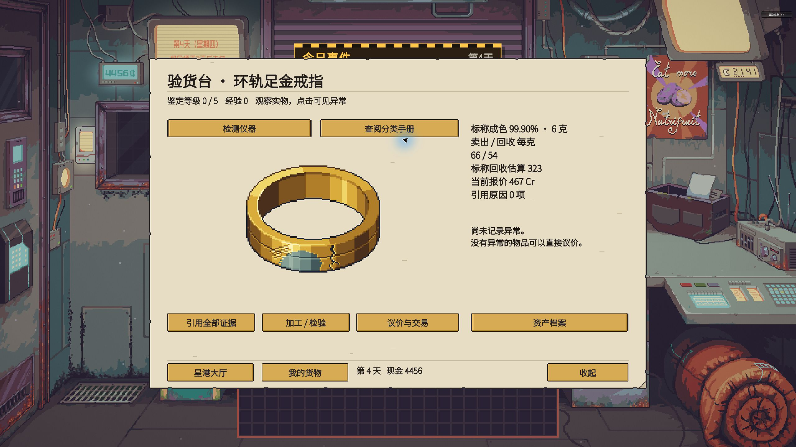
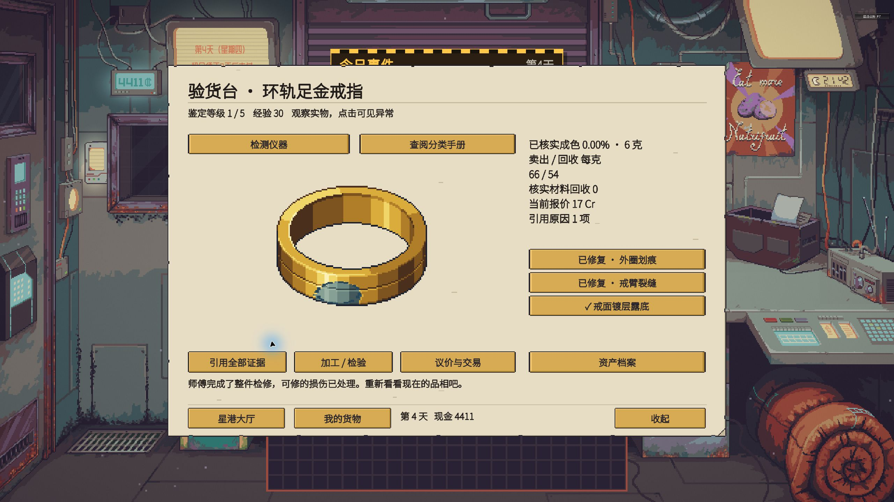
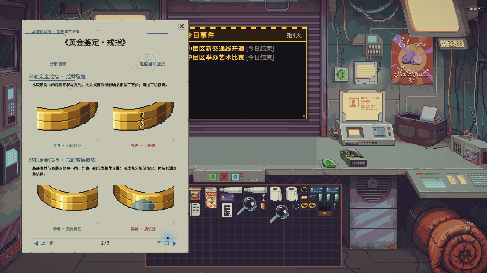
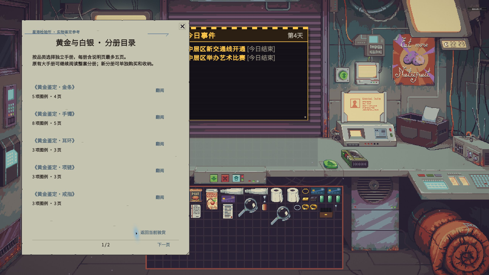
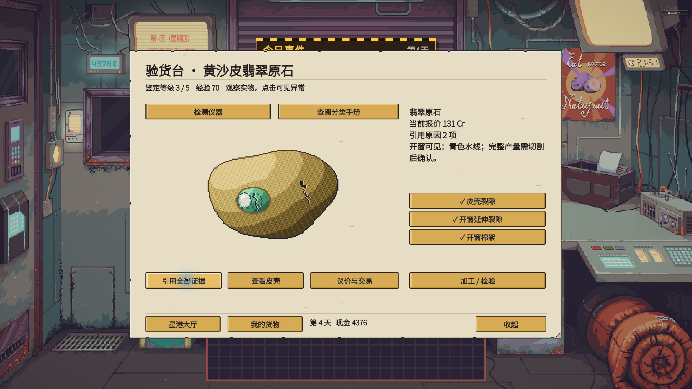
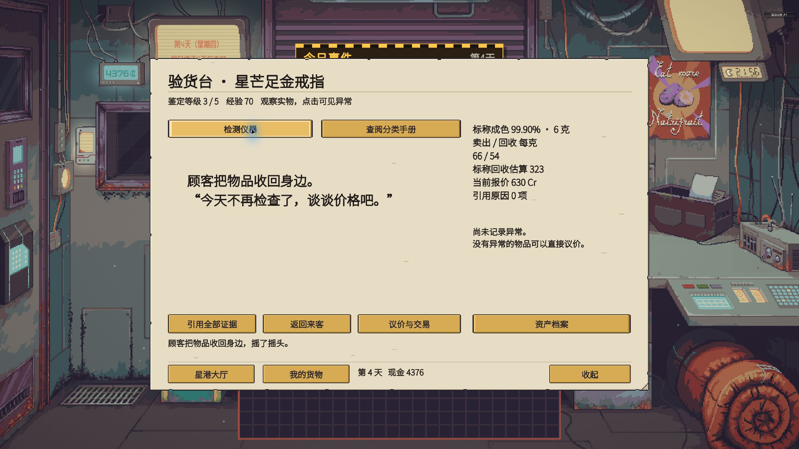
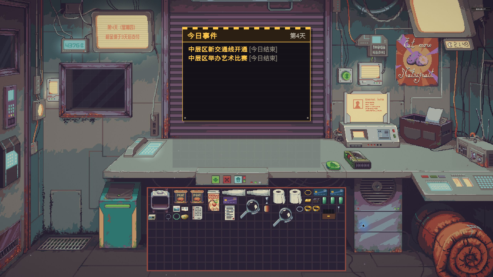
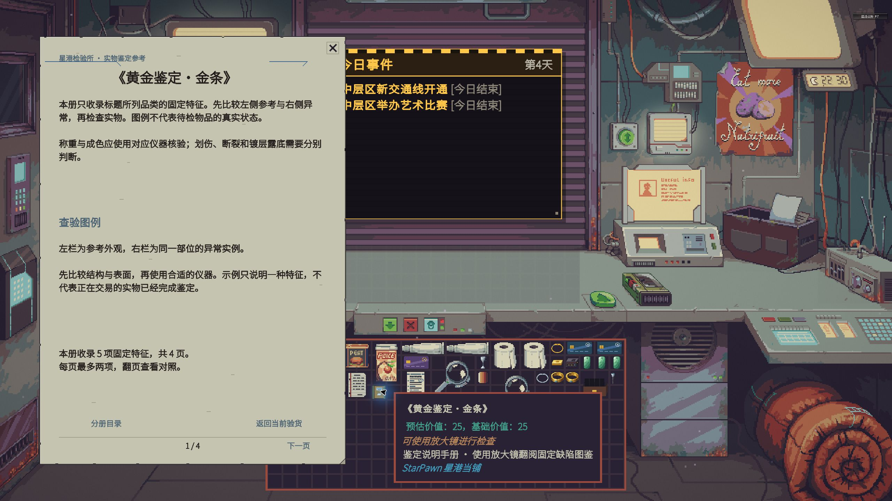
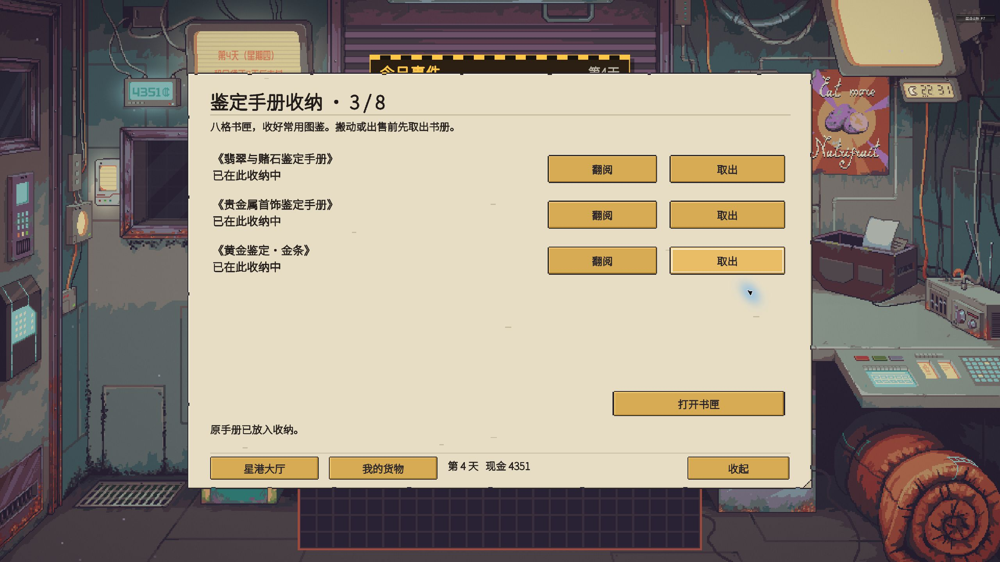
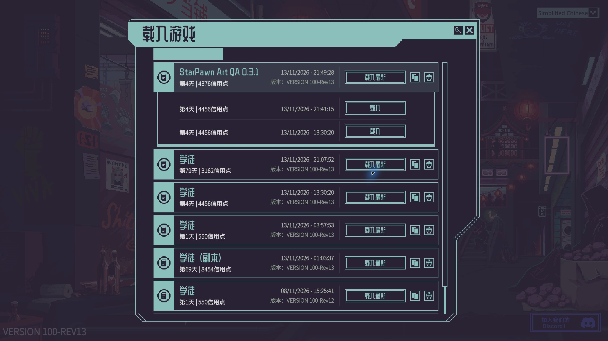

# StarPawn 0.3.1: Claude art integration and game debugging

Date: 2026-11-13. Runtime: Probably Stolen 100-Rev13, Windows, Simplified Chinese. Git branch: `integration/art04`. Art source: `art/batch04` at `05c585d7cfc81749f547768f5684a00129e864b4`.

Claude's authored sprites are now running in the existing game catalog. The integration replaces the development artwork, aligns appraisal hotspots with visible clues, and presents fixed reference examples in a portrait handbook matching the native document proportions. The screenshots below are actual 2560 x 1440 game captures, not proposal mockups.

This release keeps the 0.3 business rules and saved identities. It does **not** implement the entire 0.4 jewelry, recovery, or event expansion merely because their artwork is present.

## Delivered in the playable build

| Area | Result |
| --- | --- |
| Existing catalog | 239 definitions adapted and preserved; 15 additive short handbooks bring the catalog to 254. Condition combinations are included in this count. |
| Physical artwork | New art for the current gold/silver forms, rough and finished jade, collectibles, tools, manuals, organizer, and two cards. |
| Runtime textures | 700 generated textures, including condition states, repaired composites, handbook comparisons, and UI skins. |
| Appraisal | 307 existing evidence hotspots recalculated from each clue's effective contribution to its full composite. |
| Manuals | All 78 fixed reference/problem pairs retained. Fifteen new physical volumes plus five existing short books; every reader and collection index fits five pages, including the introduction. |
| Save compatibility | Existing definition/evidence/cause IDs, material facts, values, purity, yields, and occupied inventory cells preserved. |
| Demo | Separate slot 6, named `StarPawn Art QA 0.3.1`, with controlled ring, necklace, rough-jade, and customer fixtures. |



The ring's scratch, fracture and exposed base metal are visible on its surface. Clicking these three clues awarded 10 XP each. Clicking an already recorded clue again awarded no additional XP. This fixture deliberately contains three defects for regression testing.



Repair cost 45 credits. It removed the repairable surface damage and crack while retaining the nonrepairable plating disclosure. Repair did not restore intrinsic gold content or award repeated discovery XP.

## Bugs and integration problems fixed

| Problem | Fix and evidence |
| --- | --- |
| New artwork and old hotspot coordinates could disagree. | Hotspots are generated from actual pixel differences in the complete profile. Each visible clue must retain at least 24 paper pixels and 4 inventory pixels. |
| Combining layers can hide an earlier clue. | Validation compares the complete composite against that same composite with one clue omitted; it does not merely inspect each overlay in isolation. |
| Repair could accidentally remove plating or keep all original damage. | Separate repaired composites retain exactly the original unrepairable clues. The three-defect ring was checked in the game. |
| The old bracelet clasp floated apart from the band. | Extended the clasp attachment geometry, regenerated compatible textures and handbook crops. |
| Handbook introduction text overlapped reserved illustration slots. | Added a separate introductory page skin; comparison pages keep their two illustrated sections. |
| A proposed duplicate-page icon had no game action. | Removed the decorative icon from the runtime handbook skin. Close and page navigation remain functional. |
| The combined metals handbook ran to 21 pages. | Split metals and jade into 15 physical category volumes, each 1 x 1 cell and 25 credits. Old books retain collection access. Inspection selects the relevant volume by public product family. |
| The last handbook page retained a decorative Next arrow. | Removed baked navigation arrows; only available page controls are rendered. |
| Texture filtering blurred pixel edges. | Applied Point filtering and Clamp wrapping only to StarPawn textures. |
| Instrument readings could list the same underlying crack twice. | Deduplicated by economic cause before producing the readable list. External/window evidence remains separately discoverable. |
| Inspecting a withdrawn customer's item through instruments produced an error and returned to the hub. | The UI now stays at the appraisal desk and shows the customer's refusal. The core lock check remains in place. Retested after restarting the game. |
| The generator assumed Linux fonts. | Added Windows/system font resolution for review sheets. No system fonts are redistributed or baked into runtime text fields. |
| The proposal validator assumed forward-slash paths. | Recognizes layer folders using path components on Windows. |
| The received step-cut emerald differed from the Windows source render. | Regenerated that proposal's states/layers. The intact difference was one inventory pixel/four doubled paper pixels, with identical alpha; the actual proposal now passes the exact regeneration check. This planned gemstone is not enabled in the playable catalog. |
| Batch regeneration erased prior outputs and ignored validator failure. | Regenerates in place, stops on a failed stage, and propagates validation failure. An explicit `--integration` mode skips only the art-branch scope restriction. |



The handbook uses fixed examples from registered item layers. It does not substitute the current customer's hidden state into its illustrations. Introduction, next page, return to inspection, and close were exercised in the game.



The [volume manifest and compatibility notes](HANDBOOK_VOLUMES_031.md) list every new book and its page count. The original batch04 proposal's long book grouping is superseded by the user's five-page limit; its images remain traceable example references. Future 0.4 templates must enter additional short category books.

## Actual game checks

| Scenario | Observed result |
| --- | --- |
| Gold ring manual appraisal | Three distinct visible clues accepted; XP 0 -> 30. Duplicate click gave no XP. |
| Repair | Cash 4456 -> 4411; repaired cues disappeared, plating remained. |
| Customer patience | First miss produced a complaint; second miss withdrew the item. Reopening and reloading did not reset the lock. |
| Instruments after withdrawal | Initially exposed the UI error path; fixed build shows an in-character refusal without leaving the inspection screen. |
| Silver necklace | Exposed copper was found. Two attempted clicks on small structural details missed; this remains a readability finding, not a complete visual pass. |
| Yellow rough jade | Shell crack found. Opening cost 35 credits: cash 4411 -> 4376. Window crack and inclusion were then discovered. |
| Shared crack cause | Shell plus window evidence counted as one economic cause; the window inclusion added a second cause. Quote 224 -> 168 -> 131 when all evidence was cited. |
| Jade-light reading | Reported a limited optical observation; it did not reveal an exact hidden yield. |
| Save/reload | Reloaded slot 6 with 77 registered assets and 70 XP; cash 4376, repaired ring, opened window, discovered evidence, and customer lock survived. |
| Short handbook navigation | Gold rings open directly from inspection in 3 pages. The metals index occupies 2 pages. All 5 gold-bracelet pages were exercised, including the final page. Legacy anthology ownership still grants access. |
| Physical book purchase | Bought the gold-bar volume for 25 credits: cash 4376 -> 4351, assets 77 -> 78. The native magnifier opens its 4-page reader. |
| Organizer | The existing organizer accepted the new volume through its storage controls: 2/8 -> 3/8. Reading it from the organizer opened the correct gold-bar volume, and the native container displayed all three real books. |
| Native inventory | Cards, tools, books, jewelry and jade rendered in the existing grid. No footprint migration was applied. |



Three recorded observations correspond to two economic causes. Quotation evidence selection belongs to the current inspection session; after reloading, use “cite all evidence” to include the saved window observations in the quote.









## Automated checks and limits

The game assemblies compiled successfully against the locally installed game. The existing Newtonsoft netstandard version-unification warning CS1701 remains visible; it is not hidden or promoted to a false build failure.

All eight C# suites passed: Core 9, Appraisal 31, Content 29, Content Bootstrap 11, Economy 32, Commerce 27, Native Trade 22, and Bank Cards 10: **171 checks** in total ([suite results](../tests/test-summary-031.txt)). The six new handbook checks cover page limits, complete example coverage, public-family routing, legacy/individual ownership, invalid manifests and category separation. The existing clean extension example still loads.

The [runtime compatibility check](../tests/art-integration-validation-031.txt) compares the new catalog with the actual pre-art commit `60eddd027eccbbff92bb328ac97ed3265cf349a2`. It checks all nonpresentation fields, 267 referenced item texture keys, paired handbook examples, the 307 exported clue bounds, binary alpha, and staged/runtime image equality.

The complete proposal was rebuilt from its source in a separate working directory on Windows. The fully downloaded proposal was also validated after regenerating the corrected legacy bracelets and step-cut emerald. The [proposal validation result](../tests/art-proposal-validation-031.txt) covers **135 model rows, 71 UI rows, 6,551 item/layer PNGs, 4,142 hotspot records, 581 combined profiles, 739 template checks, and 160 historical handbook mockup pages covering 250 templates**. All asset checks passed. `--integration` was explicitly used because an integration branch necessarily also changes runtime files. Those historical mockup page counts are not the new runtime book grouping.

These geometric checks do not prove that every clue is easy to recognize. No claim is made that every future UI mockup was implemented or every combination was manually clicked in the game.

## Remaining work and visual feedback

1. **Silver necklace structural details:** strengthen the visual distinction of flattened links and the jump-ring gap at the final inspection scale. Add a more specific handbook description of the affected part. Keep the category's fixed templates and regenerate matching hotspots after changes.
2. **Expanded templates and observation views:** the full 250-template proposal includes instrument-only and planned views. This compatibility release maps existing evidence profiles; it does not silently add five new random defects to every saved item.
3. **Complete jewelry business:** gemstone identity/treatments, mounted products, settings, custom orders, demounting/remounting and associated services still require the planned runtime schema and transaction work.
4. **Physical recovery and events:** new material composition, conserved recovery/refining jobs, provenance, 15-event effect channels and native-item adapters remain 0.4 implementation work. Fictional alchemy is excluded.
5. **Final art acceptance:** verify thin jewelry at other game resolutions and with a human player. The current automated pixel-count threshold is a minimum, not aesthetic approval.
6. **Appraisal balance:** the retained 0.3 logic can disclose actual purity from a plating clue. Moving material disclosure exclusively to appropriate instruments is a separate rules change and needs migration/tests; this art pass did not change item truth.

## Demo and preservation



Load **StarPawn Art QA 0.3.1**, day 4, 4351 credits, 78 registered assets and 70 appraisal XP. The purchased gold-bar booklet is stored with the two legacy anthologies in the organizer. Press **F7** for the normal StarPawn hub. For the three controlled test items and the withdrawn customer, press **F9**, select **StarPawn Art QA (isolated slot 6)**, then press F9 again to dismiss the native debug overlay.

The QA fixture action is idempotent and refuses every slot except 6. It is only available as an explicit developer-menu action. The current demo preserves the completed checks; it is not a fresh random playthrough. Its earlier day-4 history entry at 21:41:15 has the fresh fixtures before clicks and repairs, if replaying the full sequence is desired.

Local demo files are kept in `demo/art04-20261113/` (excluded from Git). Original saves were backed up before testing. SHA-256 verification found **zero changes across 16 pre-existing save files for slots 0-5**, and **zero changes across all 32 files in the 10 subscribed Workshop mod folders**. No subscriptions were removed. The save index was updated by the native game for the new slot, and only that slot's display name was subsequently changed.

Do not replace the entire save index when restoring this demo on another installation. Use the game's load/duplicate flow or a deliberate new-slot import. The `.es3` files and all original game binaries remain local.

## Reproduction

```powershell
python source/Art/Import-Batch04.py --apply
python tests/Validate-ArtIntegration.py
./source/Build.ps1 -GameDir '<your Probably Stolen directory>'
```

For proposal regeneration, install Pillow and NumPy, then run `python art/proposals/batch04/source/build_all.py --integration` on an integration branch. Linux and Windows system fonts are supported for review sheets; override them with `STARPAWN_ZH_FONT` and `STARPAWN_EN_FONT` if needed. Review-sheet lettering may differ by installed font; runtime text is drawn by the game.

The legacy art map is an input to the legacy renderer. Do not overwrite it with new coordinates. The exported runtime audit is `art/runtime-art-map-031.json`. Installation changes belong only under `Mods/starpawn`, with the game closed; Workshop folders and base-game assemblies are not deployment targets.
